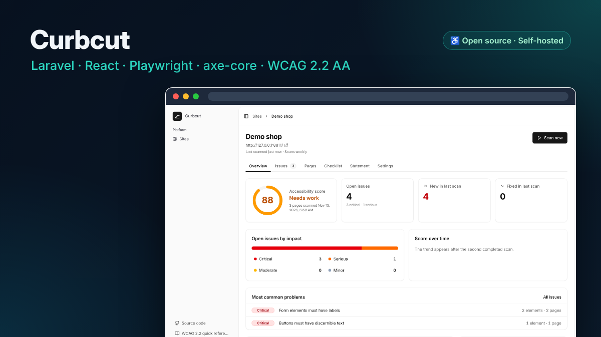
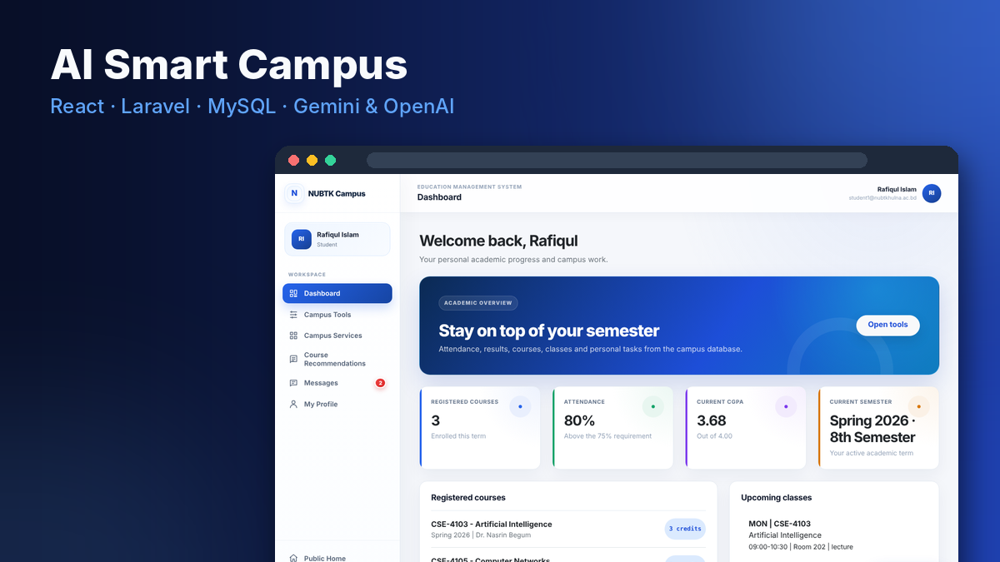
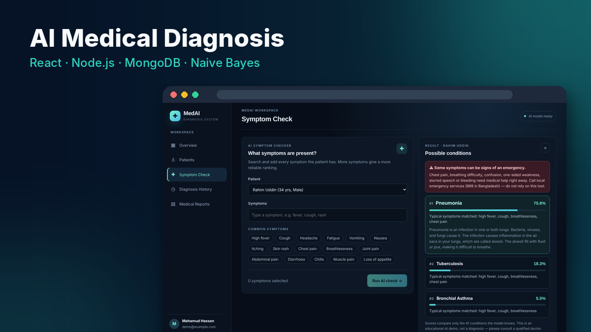
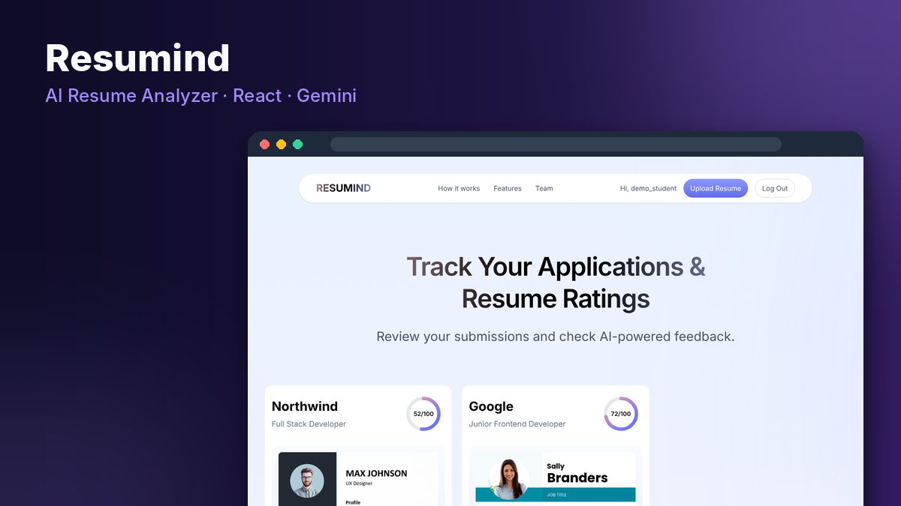
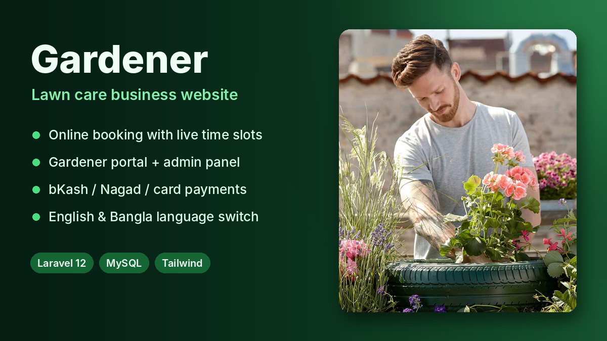
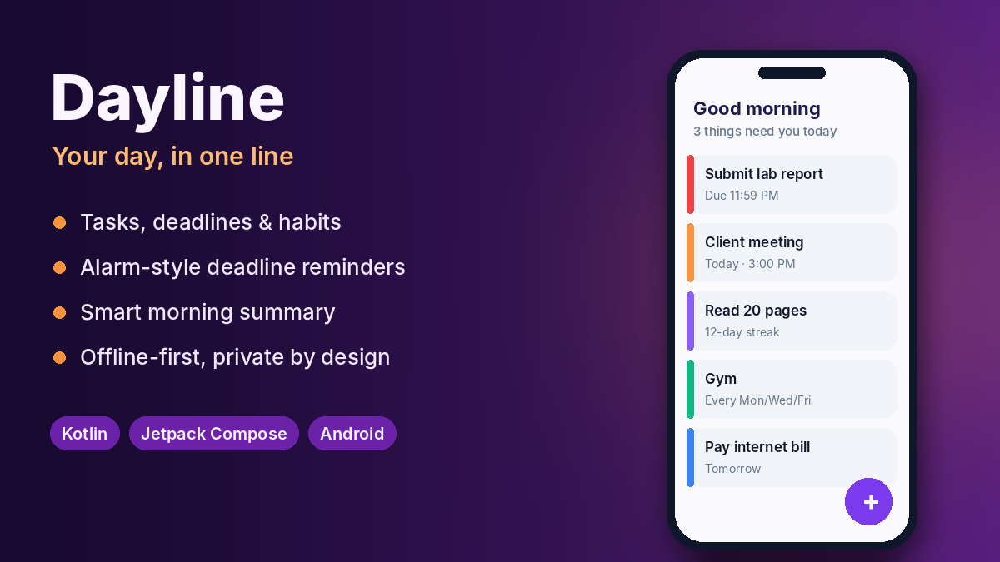
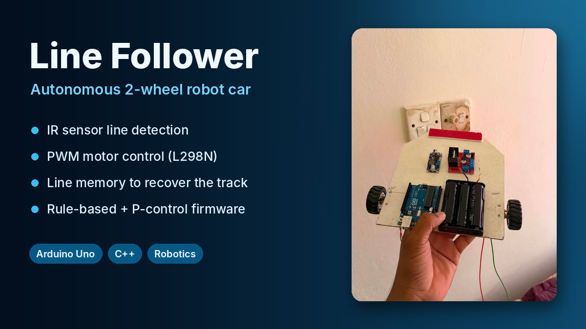

  

  

   

  
  
  
  
  

 

## 👋 About Me

I'm a **full-stack developer** and Computer Science & Engineering student who likes taking an idea all the way from database to deployed app. I build web apps with **React, Laravel and Node.js**, Android apps with **Kotlin**, I'm building **[Curbcut](https://github.com/mahamud894/curbcut)**, an open-source web accessibility compliance platform, and I add **AI** where it actually helps the user: a Gemini campus assistant, OpenAI risk analysis, AI resume scoring and a symptom-based diagnosis model.

- 🎓 **B.Sc. in Computer Science & Engineering**
- 📍 **Khulna, Bangladesh**
- 🧑‍💻 **Focus:** full-stack web apps, REST APIs, role-based systems, AI integrations, web accessibility (WCAG), clean UI
- 🚀 **Built so far:** an accessibility compliance platform, campus management, healthcare, resume analysis, lawn care booking, an Android productivity app and an Arduino robot
- 🌱 **Exploring:** TypeScript everywhere, CI/CD with GitHub Actions, cloud deployment, Jetpack Compose
- 💼 **Open to:** junior full-stack / web developer roles, internships and freelance work
- 📫 **Reach me:** mdmahamudul894@gmail.com

## 🛠️ Tech Stack

**Frontend** 

**Backend & Databases** 

**Mobile, Embedded & Languages** 

**AI & Integrations** 

**Tools & Deployment** 

## 🚀 Featured Project

<h3 align="center">♿ <a href="https://github.com/mahamud894/curbcut">Curbcut: Open-Source Web Accessibility Platform</a></h3>

  Find, fix and prove web accessibility, on your own server. Curbcut scans whole websites against <b>WCAG 2.2 AA</b> with headless Chrome and <b>axe-core</b>,
  tracks every issue from the day it appears to the day it is fixed, and gives teams a full compliance workflow: issue assignment with due dates,
  a manual checklist for all 55 WCAG 2.2 A/AA criteria, a public accessibility statement based on the EU model and a complete audit trail.
  Built as a free alternative to costly tools after the <b>European Accessibility Act</b> came into force in June 2025.

  
  
  
  
  
  
  

  
  

## 💼 Projects

<table>
  <tr>
    <td width="55%" valign="middle">
      
    </td>
    <td width="45%" valign="top">
      <h4>🎓 <a href="https://github.com/mahamud894/AI-Smart-Campus-Management-System">AI Smart Campus Management System</a></h4>
      
Academic management and student-success platform with separate student, faculty and admin workspaces. Covers attendance, grades, class routines, notices and campus services, plus a Gemini-powered campus assistant, AI course recommendations and OpenAI-assisted academic risk analysis.

      
      
      
      
      
      
    </td>
  </tr>
</table>

<table>
  <tr>
    <td width="45%" valign="top">
      <h4>🩺 <a href="https://github.com/mahamud894/ai-medical-diagnosis-system">AI Medical Diagnosis System</a></h4>
      
Full-stack web app that manages patient records and ranks possible conditions from symptoms using a trained <b>Naive Bayes</b> model. JWT authentication, dashboard, diagnosis history and a mobile-friendly UI, with CI tests and deployment on Render.

      
      
      
      
       
    </td>
    <td width="55%" valign="middle">
      
    </td>
  </tr>
</table>

<table>
  <tr>
    <td width="50%" valign="top">
      
      <h4>📄 <a href="https://github.com/mahamud894/AI_Resume_Analyzer">Resumind: AI Resume Analyzer</a></h4>
      
Upload a resume with a job description and get an AI score, ATS score and detailed tips. Tracks every application in one dashboard. <i>Team project (team lead and frontend).</i>

      
      
      
      
       
    </td>
    <td width="50%" valign="top">
      
      <h4>🌿 <a href="https://github.com/mahamud894/Lawn-Care-Website---Gardener">Gardener: Lawn Care Website</a></h4>
      
Full business website with online booking and live time slots, a gardener portal, an admin panel, bKash/Nagad/card payments and English/Bangla support.

      
      
      
      
    </td>
  </tr>
  <tr>
    <td width="50%" valign="top">
      
      <h4>🌅 <a href="https://github.com/mahamud894/Dayline-">Dayline: Task &amp; Habit Manager</a></h4>
      
Offline-first Android app for tasks, deadlines and habits, with alarm-style reminders, a smart morning summary and forgiving streaks.

      
      
      
    </td>
    <td width="50%" valign="top">
      
      <h4>🤖 <a href="https://github.com/mahamud894/Line-Following-Robot-Car">Line Following Robot Car</a></h4>
      
Arduino robot car that follows a black line on its own using IR sensors, PWM motor control and line memory, with rule-based and proportional-control firmware.

      
      
      
    </td>
  </tr>
</table>

## 📊 GitHub Activity

  
  
    
  
    
  

## 🌱 Currently Working On

- ♿ **Curbcut:** next up are PDF audit reports, an agency mode for many clients, a one-command Docker install and a GitHub Action that fails pull requests on new accessibility issues
- 🎓 **AI Smart Campus:** polishing the student, faculty and admin workspaces and the AI risk analysis
- 🩺 **AI Medical Diagnosis:** improving the diagnosis model and the patient workflow
- ⚙️ Adding CI with GitHub Actions and Docker-based deployment to my projects
- 📱 Polishing Android apps with Jetpack Compose

   
  <i>"Build it, ship it, then make it better."</i>
    
  

